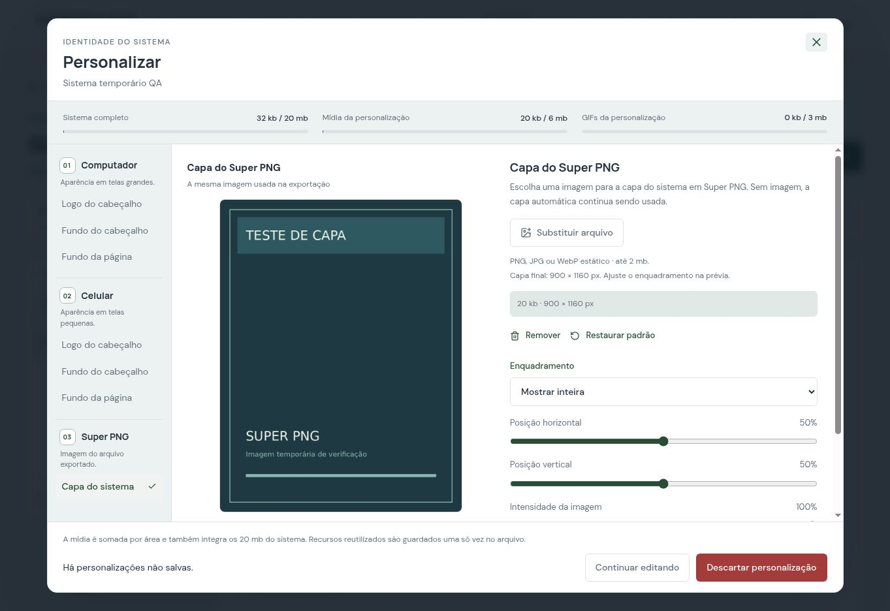
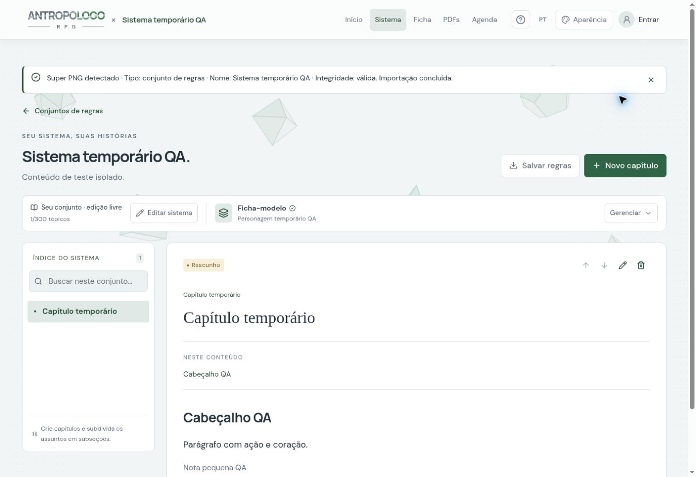

# ANTROPOLOGO RPG — QA global e estabilização

Data: 1 de novembro de 2026. Versão da aplicação: **0.38.0**, exibida como **0.38**, mantida nesta auditoria.

Foram corrigidos defeitos reproduzidos com dados controlados, sem reescrever regras, alterar mecânicas, ampliar cotas, trocar editores ou redesenhar o site. A execução abrangeu testes automatizados, inspeção de código e fluxos reais no Chrome; essas três formas de verificação estão diferenciadas abaixo.

## Preservação e ambiente

- Estado inicial preservado no commit `2c424e550659d9d77d2de7b4bac14517613a5f8d` e no arquivo `antropologo-pre-qa-global-0_38.zip`, criado antes das mudanças.
- Nenhum conteúdo cadastrado pelo usuário foi usado para edição destrutiva. Os testes manuais utilizaram “Sistema temporário QA”, “Personagem temporário QA”, uma capa e um PDF criados para esta auditoria.
- Os dois conjuntos temporários resultantes da importação e da reimportação foram removidos depois de exportados. A ficha e o PDF locais desapareceram na atualização da página, conforme o comportamento atual da versão de teste.
- Foram preservados o projeto Sites existente, sua audiência pública, os vínculos D1/R2 e o formato atual de armazenamento/importação/exportação.
- Automação: Node **24.22.1**, React e **JSDOM 26.1.0**, com IndexedDB simulado por `fake-indexeddb`. JSDOM não reproduz layout nativo, teclado virtual nem desempenho de um celular.
- Verificação manual: **Chrome desktop**, na publicação do próprio projeto, em aba de teste sem conta e sem dados reais.

## Resultado dos checks

| Verificação | Resultado observado |
| --- | --- |
| Bateria inicial | **368 testes aprovados**, nenhuma falha |
| Bateria final | **392 testes aprovados**, nenhuma falha, cancelamento ou teste ignorado; 53 arquivos de testes; 56,90 s |
| TypeScript, `tsc --noEmit` | Aprovado |
| `git diff --check` | Aprovado |
| Build de produção | Aprovado |
| Lint completo | **Não aprovado: 59 erros e 61 avisos remanescentes em 35 arquivos** |
| Navegador, registros coletados | 214 mensagens da extensão do ambiente; nenhuma mensagem de erro/aviso atribuída ao código do site nessa coleta |

O lint não é apresentado como aprovado. Permanecem apontamentos anteriores, principalmente tipagem com `any`, variáveis/importações sem uso e padrões de efeitos/refs dos componentes existentes. Os arquivos novos de proteção de rede e validação de respostas passaram sem apontamentos. Os problemas de lint introduzidos durante a implementação foram removidos antes da entrega. Corrigir toda a dívida de hooks e tipagem exigiria uma intervenção maior nos componentes existentes; isso permanece como trabalho técnico separado.

O build continua emitindo o aviso anterior sobre um pacote JavaScript acima de 500 kB, aproximadamente 850 kB antes da compressão. A auditoria não tratou esse aviso como erro de compilação nem realizou uma divisão invasiva dos editores.

## Defeitos confirmados e correções

| ID e gravidade | Reprodução e comportamento observado antes | Resultado esperado e correção aplicada | Componentes e validação |
| --- | --- | --- | --- |
| QA-01 — Crítico: referência de cache sem conteúdo | Abortar a primeira gravação e iniciar outra com o mesmo objeto de sistema. A segunda podia atualizar os metadados sem regravar o livro que não havia sido confirmado. | Atualizar referências somente após a confirmação da transação e regravar defensivamente os registros ainda pendentes. As transações aceitas continuam sendo abertas imediatamente, conservando o fechamento/reabertura seguro. | `lib/platform-session.ts`; abortar/repetir, gravações sobrepostas, remover/recolocar e fechar/reabrir aprovados. |
| QA-02 — Crítico: restauração malsucedida sobrescrevia cache | Forçar uma falha na leitura inicial. A conexão já habilitada para escrita permitia salvar o estado inicial vazio sobre a cópia anterior. | Habilitar gravações somente após restaurar com sucesso. Em falha, fechar a conexão, preservar o cache e mostrar orientação de exportação. | `app/page.tsx`; falha injetada e recuperação da cópia anterior aprovadas. |
| QA-03 — Crítico: inicialização podia ficar bloqueada | Simular abertura de IndexedDB sem resposta; também simular uma leitura que nunca entrega resultado. A interface podia ficar em preparação indefinidamente. | Limitar abertura e leitura a **8 segundos por etapa**. Liberar a interface com aviso, sem gravar sobre dados que não puderam ser recuperados. Fechar conexões que chegam depois do prazo. | `lib/platform-session.ts`, `app/page.tsx`; testes de timeout e preservação do conteúdo aprovados. |
| QA-04 — Moderado: pedidos de rede deixavam controles presos | Deixar `fetch` ou a leitura do corpo JSON sem resposta, inclusive ignorando o sinal de cancelamento. A operação não encerrava. | Prazo total de **15 segundos por pedido lógico**, com cancelamento e mensagem de recuperação. Leituras GET podem repetir uma falha transitória uma vez; mutações não são repetidas automaticamente. | `lib/browser-request.ts`, `app/player-space.tsx`, `app/page.tsx`; rede pendurada, corpo pendurado, HTML de gateway, status 401/429 e timeout de mutação aprovados. |
| QA-05 — Crítico: resposta inválida derrubava a biblioteca | Fazer `/api/library` devolver um objeto em vez de uma lista. O código chamava `filter` sobre um valor incompatível. Respostas malformadas de agenda/perfil também não eram validadas na fronteira. | Validar estrutura antes de atualizar estado, rejeitar URLs executáveis e apresentar erro recuperável. As outras áreas continuam navegáveis. | `lib/api-responses.ts`, `app/page.tsx`, `app/player-space.tsx`; payloads inválidos, recuperação e protocolos inadequados aprovados. |
| QA-06 — Moderado: leitura antiga apagava sessão recém-criada da tela | Manter um GET da agenda pendente, concluir um POST e então devolver a lista antiga. Ela substituía o estado com a sessão recém-salva. | Aceitar resultados somente da consulta atual e somente se nenhuma mutação tiver alterado o conteúdo desde o início da leitura. | `app/player-space.tsx`; corrida GET/POST reproduzida antes e aprovada depois. Teste de interface simulado, sem alterar agenda real. |
| QA-07 — Leve: foco repetido duplicava consultas | Disparar cinco eventos de foco enquanto a consulta de autenticação anterior ainda estava pendente. Eram iniciados cinco pedidos. | Compartilhar o pedido em andamento e impedir que uma atualização por foco sobreponha entrada/saída da conta. | `app/player-space.tsx`; **5 pedidos para 1** no cenário controlado. |
| QA-08 — Moderado: fechar personalização descartava rascunho | Adicionar uma imagem ou alterar sua configuração e fechar pelo X, Cancelar ou Escape. As mudanças eram descartadas sem escolha explícita. | Aviso de alterações pendentes com “Continuar editando” e “Descartar personalização”. Manter o salvamento existente e o aviso ao sair da página. | `app/system-visual-editor.tsx/.css`; teste automatizado e fluxo real no Chrome aprovados. |
| QA-09 — Moderado: resposta atrasada removia PDF local | Adicionar um PDF enquanto a consulta inicial da biblioteca estava pendente; depois retornar a lista remota antiga. O PDF adicionado desaparecia. | Mesclar o catálogo remoto com os arquivos locais ainda presentes, sem duplicar IDs. | `lib/api-responses.ts`, `app/page.tsx`; teste puro e corrida na interface simulada aprovados. |
| QA-10 — Moderado: falha remota ocultava PDFs locais | Forçar falha do catálogo e adicionar um arquivo local. O estado de erro ocupava o lugar da lista, impedindo acesso ao PDF. | Mostrar o erro separadamente e manter os cartões locais disponíveis. | `app/page.tsx`; reprodução com 503 e inclusão de PDF aprovadas. |

As falhas de cota e de escrita síncrona também passam a produzir rejeições tratáveis. Uma confirmação de gravação posterior elimina o aviso de erro anterior. O cache continua sendo um recurso local de sessão; exportar JSON ou Super PNG permanece sendo a forma de guardar uma cópia independente.

## Proteções contra falhas e decisões técnicas

- O prazo de rede cobre conexão e leitura do corpo. O temporizador é limpo ao concluir e o sinal de abort é propagado.
- GET repete no máximo uma vez em falha de rede ou status 502/503/504. Não repete 401, 429 ou respostas válidas com formato incompatível.
- POST, PUT e DELETE não são reenviados automaticamente. Quando não é possível confirmar uma mutação, a mensagem informa que ela pode já ter sido concluída e orienta verificar os dados antes de tentar de novo.
- Respostas de perfil, agenda e catálogo são validadas antes de chegar aos componentes. Isso complementa as validações do servidor e dos arquivos importados, sem substituí-las.
- Contadores de revisão impedem resultados antigos de sobrescrever dados mais novos na agenda. IDs de autenticação continuam protegendo mudanças de conta.
- Não foram acrescentados salvamento automático, novas estruturas de conta, novos formatos de arquivos ou limites maiores.

## Otimizações verificadas

A grade da agenda passa a construir um índice por data em uma única passagem. A grade, suas ocorrências e o índice são memorizados por mês e conjunto filtrado, evitando filtrar a lista inteira em cada uma das 42 células. A busca das próximas sessões preserva o cálculo temporal atual.

| Cenário controlado | Antes | Depois | Alcance da medição |
| --- | --- | --- | --- |
| Agrupamento de 3.000 ocorrências de 500 séries semanais em 42 dias | Mediana **1,388 ms** | Mediana **0,053 ms** | 101 amostras; mesmos resultados e ordem; aproximadamente **96% menos tempo nessa operação isolada** |
| Cinco focos com autenticação pendente | 5 consultas | 1 consulta | Teste de interface com rede controlada |

Esses números não representam uma aceleração de 96% do site inteiro. Não foram medidas taxa de quadros ou memória em dispositivos móveis reais.

## Cobertura automatizada executada

| Área | Cenários executados | Resultado |
| --- | --- | --- |
| Editor de regras | Texto, acentos, seleção/cursor, marcadores de cabeçalhos e texto pequeno, Live Preview, Enter/Backspace, formatação, histórico e serialização | Aprovado na bateria Node/JSDOM |
| Fichas | Migrações, campos, cálculos, referências, conexões, layout, imagens, ficha-modelo e atualização de vínculo | Aprovado |
| Dados e rolagens | Dados numéricos e simbólicos, expressões, categorias, Roll and Keep e limites de seleção | Aprovado; o motor não foi alterado |
| JSON e Super PNG | Ida e volta, arquivos antigos, metadados/CRC, cotas, corrupção, expansão excessiva e degradação segura | Aprovado |
| Agenda | Datas, recorrências, limites de mês, horário de Brasília, ordenação, índice por data e corridas de respostas | Aprovado |
| Contexto e temas | Contexto global/sistema, Perfil global, paletas, remoção de sistema, restauração, proteção de rascunhos e importação de personalização | Aprovado em testes simulados |
| Ambientação | Geometria, rotação, quantidade de elementos, interação e condições de movimento reduzido/visibilidade | Aprovado em testes existentes; sem medição de GPU real |
| Falhas | IndexedDB bloqueado/abortado/sem resposta, cota, rede sem resposta, JSON inválido, gateway HTML e respostas antigas | Aprovado |

Comando da bateria final:

```sh
node --test --test-concurrency=1 --test-reporter=tap --test-timeout=60000 tests/*.test.mjs
```

Os testes de regras não utilizaram textos reais de sistemas cadastrados. Os casos de mobile da bateria verificam estados, funções e geometria simulada; não equivalem à validação do teclado ou do navegador de um telefone.

## Fluxos reais executados no Chrome

| Fluxo | Evidência observada |
| --- | --- |
| Aparência | Seleção das oito paletas em claro e escuro: **16 combinações**. Estado e cores atualizados; nenhuma rolagem horizontal na janela desktop usada. Não foi uma auditoria instrumental completa de contraste. |
| Importação de sistema temporário | JSON carregado, capítulo e ficha-modelo reconhecidos. |
| Escrita | Digitar `## `, continuar o cabeçalho, Enter para parágrafo normal, acentos, desfazer/refazer, `-# ` e salvar. Cabeçalho e nota apareceram corretamente na leitura. |
| Recuperação | Recarregar a página: sistema, capítulo salvo e estilos reapareceram. |
| Personalização | Upload de capa estática, tentativa de fechar, aviso de rascunho, “Continuar editando” e salvar. |
| Exportação | Baixar JSON e Super PNG personalizados. Verificação local confirmou **payloads idênticos** e CRC válido. O PNG tinha 60.087 bytes. |
| Reimportação real | Carregar o PNG baixado: confirmação “Integridade: válida”, capítulo, cabeçalho, nota e ficha-modelo presentes. |
| Ficha | Importar ficha de teste; valores calculados e blocos apresentados; abrir rolagem avulsa. |
| Rolagem numérica | `2d6 + 3`: resultados 3 e 6, soma dos dados 9 e total 12 após a animação. |
| PDFs | Adicionar PDF local válido, localizar por busca e verificar ações de abrir/baixar. O arquivo não foi enviado ao servidor. |
| Navegação | Sistema temporário entre Home, Sistema, Ficha, PDFs e Agenda; trocar para AB10, recarregar e manter contexto; logo restaura modo global. |
| Agenda sem autenticação | Página explicativa e acesso à conta exibidos, mantendo o contexto. Não foi criada conta real. |
| Limpeza | Remover somente os dois conjuntos temporários e retornar à Home global; AB10 permaneceu. |





## Editor com documentos extensos

Script executado: `node tests/rule-editor-performance.mjs`. Foram 50 amostras de inserção e seleção por cenário no Node/JSDOM.

| Palavras | Caracteres | Inserção p95 | Seleção p95 | Salvar e reabrir |
| --- | --- | --- | --- | --- |
| 500 | 3.140 | 1,041 ms | 0,947 ms | Aprovado |
| 2.000 | 12.420 | 0,584 ms | 0,331 ms | Aprovado |
| 5.000 | 30.980 | 0,617 ms | 0,606 ms | Aprovado |
| 10.000 | 61.913 | 0,488 ms | 0,248 ms | Recusado pelo limite existente |
| 20.000 | 123.780 | 0,563 ms | 0,389 ms | Recusado pelo limite existente |

Os dois últimos documentos excedem os **50.000 caracteres por conteúdo** já definidos. A recusa foi o resultado esperado, e não uma aprovação do salvamento desses tamanhos. Nenhuma cota foi ampliada. Os tempos medem a execução simulada; não são latência de teclado, layout ou renderização de um navegador real.

## Inspeção e limites de validação

Foram inspecionados os fluxos de conta, cookies, autorização por proprietário, origem das requisições, importação, limites e protocolos. As verificações puras existentes de autenticação/credenciais passaram. Isso não substitui teste de intrusão nem comprova isolamento entre contas reais em produção.

A primeira consulta aos logs recentes do Worker não retornou erros. Uma consulta posterior, após a publicação, retornou somente 404 de crawler para `/robots.txt` e `/sitemap.xml`, com execução normal do Worker; não foram observadas exceções da aplicação nessa consulta. Esses caminhos de descoberta não possuem arquivos no projeto atual. Isso foi registrado como recomendação de publicação/SEO, sem criar novas páginas nesta estabilização.

**Não testado efetivamente neste ambiente:**

- Android, iOS, Safari e Firefox reais; teclado virtual, seleção por toque, barras móveis do navegador, orientação e leitores de tela nativos.
- Ciclo autenticado completo contra o banco real, isolamento entre duas contas, expiração aguardada por duas horas e operações concorrentes entre clientes reais.
- Testes de carga, métricas de GPU, detecção de vazamento de memória em uso prolongado e indisponibilidade real dos serviços D1/R2.
- Auditoria completa de vulnerabilidades de dependências.
- Integração `tests/demo-auth.integration.ts`, que requer Worker de desenvolvimento com rota de teste isolada. Essa rota não foi publicada.

O preview local gerenciado não pôde iniciar porque já havia outro servidor do ambiente usando a infraestrutura de preview. Nenhum processo foi encerrado e nenhuma proteção de infraestrutura foi alterada para contornar esse impedimento. Os testes funcionais possíveis foram executados no Node/JSDOM e os fluxos manuais na publicação em Chrome.

## Pendências recomendadas

1. Tratar a dívida de lint em uma tarefa de tipagem e hooks, com revisão por componente e regressão dedicada.
2. Medir e dividir os pacotes dos editores pesados em uma etapa própria; o aviso de bundle permanece.
3. Executar matriz física Android/iOS e navegadores adicionais, incluindo teclado virtual e movimento reduzido nativo.
4. Executar integração autenticada e concorrência em banco isolado, sem contas reais de usuários.
5. Caso a publicação deva ser indexada, definir intencionalmente `robots.txt` e sitemap; não inferir essa política a partir de acessos de crawler.

As correções entregues permanecem localizadas em recuperação de sessão, fronteira de rede, consistência de estado, agenda e proteção da personalização. Os editores, as mecânicas de rolagem e os conteúdos existentes foram preservados.
