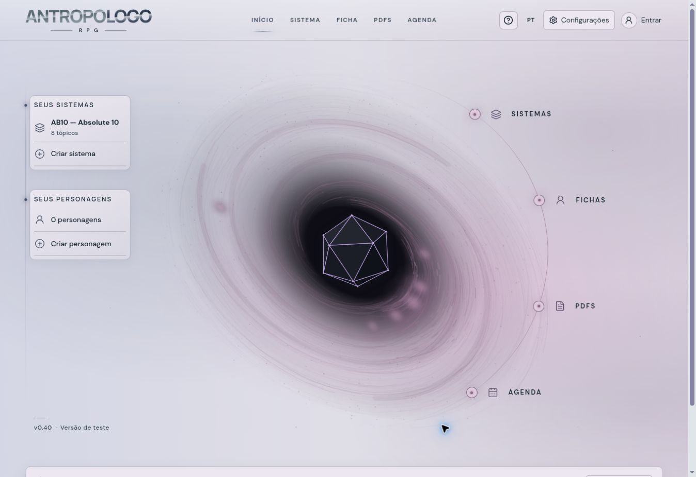
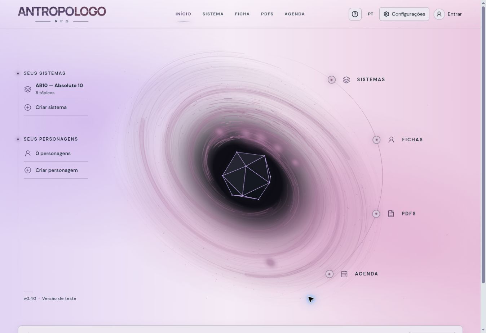
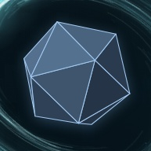
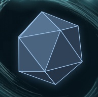

# Home Orbital v0.40

## Refinamento do modo claro

Comparativo no Chromium a 1348 × 926, com a mesma paleta Ametista e Rosa.
A referência anterior é a publicação 91. A nova revisão está em prévia.

| Base da publicação 91 | Prévia do refinamento |
| --- | --- |
|  |  |

| Tela | Modo e paletas | Captura |
| --- | --- | --- |
| Desktop | Claro · Floresta e Dourado | [Abrir](modo-claro-floresta-dourado.jpg) |
| Desktop | Claro · Safira e Ciano | [Abrir](modo-claro-safira-ciano.jpg) |
| Desktop | Escuro · Ametista e Rosa | [Abrir](modo-escuro-depois.jpg) |
| Celular emulado · 405 × 871 | Claro · Ametista e Rosa | [Abrir](modo-claro-mobile.jpg) |

Para abrir a prévia local na branch `dev/v0.40-atmosfera-procedural`, siga as
[instruções da aplicação](../../aplicacao/v0.40/docs/home-orbital-v040.md#executar-localmente).

## Registro da revisão anterior

As imagens abaixo registram o desenvolvimento a partir da publicação 90.
As capturas de celular deste registro usam o viewport de 390 × 844.

## Comparativo em Ametista e Rosa

| Base da publicação 90 | Prévia do refinamento |
| --- | --- |
|  |  |

## Paletas e modos

| Tela | Modo e paletas | Captura |
| --- | --- | --- |
| Desktop | Claro · Floresta e Dourado | [Abrir](home-claro-floresta-dourado.jpg) |
| Desktop | Claro · Ametista e Rosa | [Abrir](home-claro-ametista-rosa.jpg) |
| Desktop | Escuro · Floresta e Dourado | [Abrir](home-escuro-floresta-dourado.jpg) |
| Desktop | Escuro · Ouro e Cobre | [Abrir](home-escuro-ouro-cobre.jpg) |
| Desktop | Escuro · Âmbar e Menta | [Abrir](home-escuro-ambar-menta.jpg) |
| Desktop | Escuro · Safira e Ciano | [Abrir](home-escuro-safira-ciano.jpg) |
| Celular | Escuro · Safira e Violeta | [Abrir](mobile-escuro-safira-violeta.jpg) |
| Celular | Claro · Floresta e Dourado | [Abrir](mobile-claro-floresta-dourado.jpg) |

## D20 em rotação

| Quadro 1 | Quadro 2 | Quadro 3 | Quadro 4 |
| --- | --- | --- | --- |
|  |  |  |  |

O dado permanece no centro da espiral. Os quatro quadros mostram as faces
opacas, a luz nas arestas e vértices e orientações distintas do icosaedro.

[Configurações → Aparência](aparencia.jpg) · [Implementação e testes](../../aplicacao/v0.40/docs/home-orbital-v040.md)
