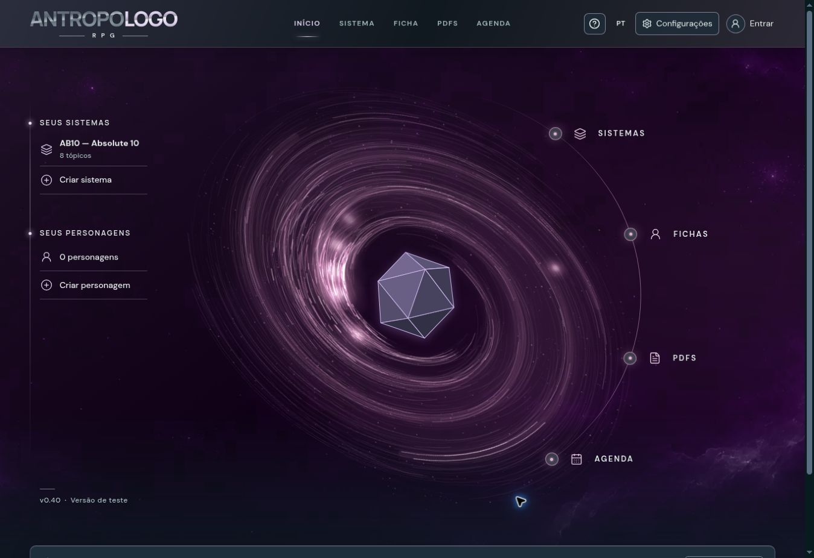
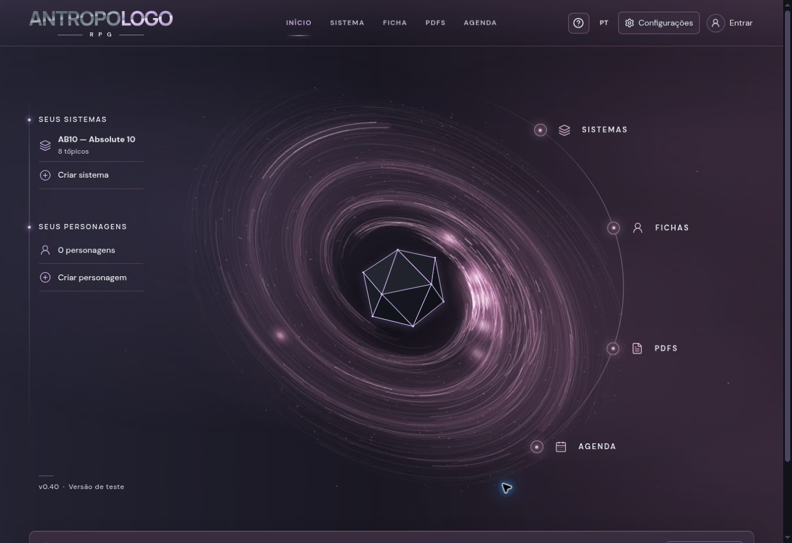

# Home Orbital v0.40

Capturas da aplicação em prévia no Chromium, com sessão de visitante. As
imagens de desktop medem 1348 × 926. As de celular usam um viewport de
390 × 844. A revisão parte da publicação 90 do ChatGPT Sites.

## Comparativo em Ametista e Rosa

| Base da publicação 90 | Prévia do refinamento |
| --- | --- |
|  |  |

## Paletas e modos

| Tela | Modo e paletas | Captura |
| --- | --- | --- |
| Desktop | Claro · Floresta e Dourado | [Abrir](home-claro-floresta-dourado.jpg) |
| Desktop | Claro · Ametista e Rosa | [Abrir](home-claro-ametista-rosa.jpg) |
| Desktop | Escuro · Floresta e Dourado | [Abrir](home-escuro-floresta-dourado.jpg) |
| Desktop | Escuro · Ouro e Cobre | [Abrir](home-escuro-ouro-cobre.jpg) |
| Desktop | Escuro · Âmbar e Menta | [Abrir](home-escuro-ambar-menta.jpg) |
| Desktop | Escuro · Safira e Ciano | [Abrir](home-escuro-safira-ciano.jpg) |
| Celular | Escuro · Safira e Violeta | [Abrir](mobile-escuro-safira-violeta.jpg) |
| Celular | Claro · Floresta e Dourado | [Abrir](mobile-claro-floresta-dourado.jpg) |

## D20 em rotação

| Quadro 1 | Quadro 2 | Quadro 3 | Quadro 4 |
| --- | --- | --- | --- |
|  |  |  |  |

O dado permanece no centro da espiral. Os quatro quadros mostram as faces
opacas, a luz nas arestas e vértices e orientações distintas do icosaedro.

[Configurações → Aparência](aparencia.jpg) · [Implementação e testes](../../aplicacao/v0.40/docs/home-orbital-v040.md)
