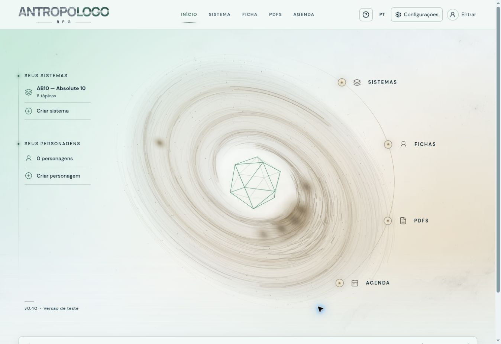
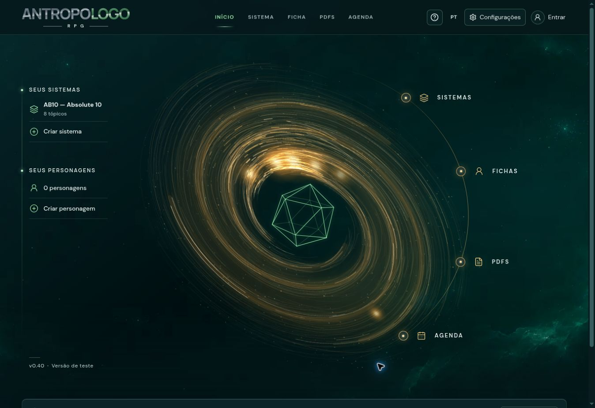
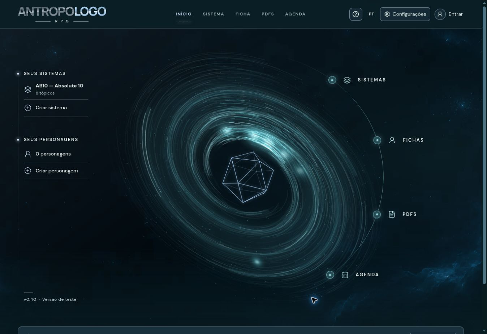
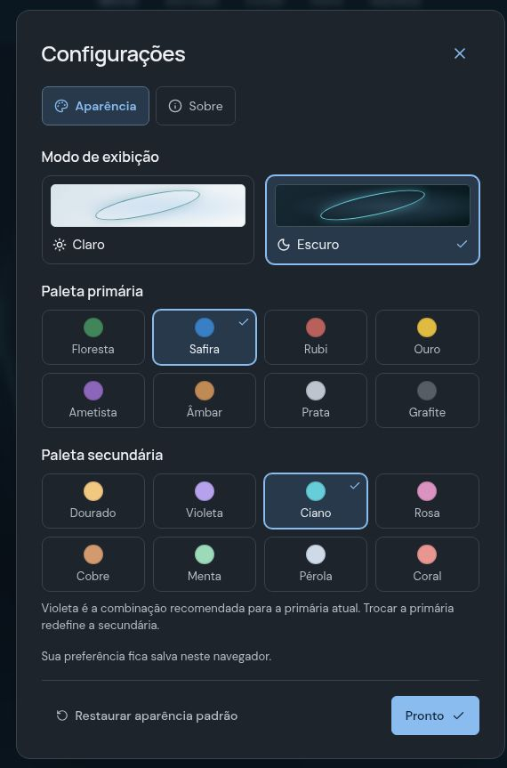
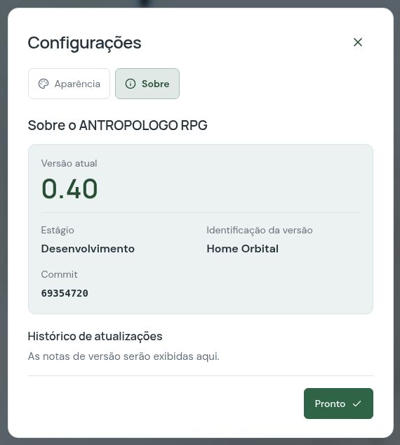

# Home Orbital v0.40

Capturas da publicação 89 do projeto original no ChatGPT Sites, verificadas no Chromium desktop. A aba Sobre identifica a edição Home Orbital, em Desenvolvimento, com o build `69354720`.

## Home no modo claro

Floresta e Dourado compõem a aparência padrão. A textura da nebulosa, os filamentos, os textos e os controles usam superfícies e contrastes próprios do modo claro.

## Home no modo escuro

O mesmo par mantém a espiral dourada e o D20 verde no fundo azul-petróleo.

Safira aplica Violeta como recomendação. A combinação abaixo mostra Ciano escolhido na seção de paleta secundária.

## Configurações

A aba Aparência apresenta os modos de exibição e os dois conjuntos de oito cartões. O destaque e a marca de seleção identificam as opções ativas. **Restaurar aparência padrão** retorna a Claro, Floresta e Dourado.

## Validação e restauração

O build, a checagem TypeScript e os 401 testes da aplicação passaram. A suíte completa executou com `--test-force-exit` para encerrar os recursos que o ambiente de teste de DOM mantém abertos. Os 11 testes do atlas também passaram.

Na prévia, a validação cobriu os oito pares recomendados, a seleção independente, a persistência após recarga, as animações, o foco orbital, as quatro rotas e o layout emulado de 390 × 844. No endereço público, foram conferidos os dois modos, os cartões, a recarga, a restauração, a aba Sobre, a animação e a abertura de Sistemas pela navegação orbital. A avaliação em aparelhos físicos fica pendente.

Para reverter no Sites, republique a versão 88 no histórico do projeto original. A versão 87 preserva a v0.38 Alpha, correspondente à tag `v0.38-alpha` no GitHub. As duas versões têm artefatos salvos. A publicação 89 usa os mesmos vínculos D1 e R2 e as mesmas migrações da 88.

[Site público](https://antrobologorpg.guss04.chatgpt.site/#inicio) · [Arquitetura, pares e comandos de desenvolvimento](../../aplicacao/v0.40/docs/home-orbital-v040.md)
