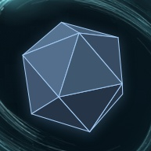

# Home Orbital v0.40

Capturas da prévia isolada em Chromium a 1440 × 900, com sessão de visitante e dados locais de teste. O site público segue identificado pela publicação 89.

| Modo e par de paletas | Captura |
| --- | --- |
| Claro · Floresta e Dourado | [Abrir](home-claro-floresta-dourado.jpg) |
| Claro · Ametista e Rosa | [Abrir](home-claro-ametista-rosa.jpg) |
| Escuro · Floresta e Dourado | [Abrir](home-escuro-floresta-dourado.jpg) |
| Escuro · Safira e Ciano | [Abrir](home-escuro-safira-ciano.jpg) |

## D20 em rotação

| Quadro 1 | Quadro 2 | Quadro 3 | Quadro 4 |
| --- | --- | --- | --- |
|  |  |  |  |

Os quatro quadros mostram o mesmo dado no centro da espiral. A malha tem 20 faces opacas. A projeção omite as faces traseiras.

[Configurações → Aparência](aparencia.jpg) · [Configurações → Sobre](sobre.jpg)

A validação no navegador conferiu os dois modos, a troca de paletas, a recarga, a opacidade, a animação, os atalhos orbitais e o movimento reduzido.

[Implementação da Home Orbital](../../aplicacao/v0.40/docs/home-orbital-v040.md)
