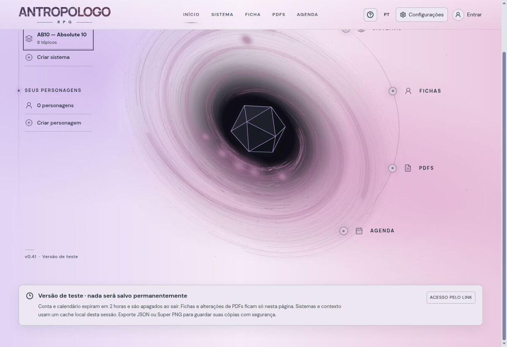
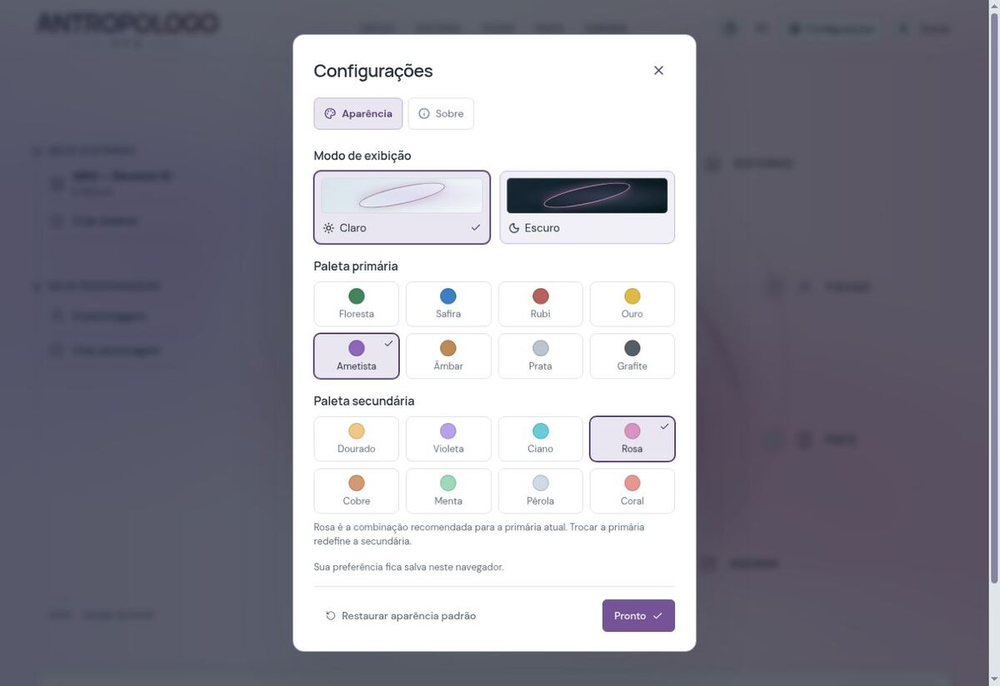

# Home Orbital v0.41

A v0.41 parte da publicação 92, que corresponde à v0.40 e ao commit
`52ac7d1a` do ChatGPT Sites. A referência no GitHub é o commit `574a333c`
da branch `dev/v0.40-atmosfera-procedural`. A v0.41 está na branch
`dev/v0.41-d20-orbital`, no diretório existente `aplicacao/v0.40/`.
O número mostrado na aba Sobre vem de `package.json`.

## D20 e navegação orbital

As 20 faces triangulares são preenchidas em tons escuros e opacos.
O traçado SVG usa os mesmos vértices projetados das faces e desenha
uma só vez cada aresta compartilhada por faces visíveis ou da silhueta.
As arestas terminam no vértice, com extremidades retas.

A velocidade do D20 converge para 20% em hover ou foco visível de
Sistemas, Fichas, PDFs ou Agenda. A integração da velocidade ao longo do
tempo preserva a orientação nas mudanças rápidas e na retomada.
A espiral e o pulso do fio conservam suas animações. Com movimento
reduzido, o D20 permanece na orientação já renderizada.

## Galeria

| Modo claro | Modo escuro |
| --- | --- |
|  |  |

[Vídeo do D20 antes, durante e depois do hover em Fichas](d20-desaceleracao.mp4).
A gravação usa 44 capturas reais no Chromium, com intervalo mediano de
160 ms. A espiral permanece em movimento durante as três etapas.

## Verificação

- Build, TypeScript e 413 testes automatizados passaram. A geometria foi
  examinada em 96 orientações, com verificação de arestas únicas, culling
  e cobertura da silhueta. O teste de rotação compara 30 e 60 quadros por segundo.
- Na prévia Chromium, foram verificados os quatro hovers, os quatro
  destinos, foco por teclado, troca rápida de foco, ambos os temas e a aba
  Sobre. Movimento reduzido, pausa fora da tela e toque foram cobertos
  pelos testes de regressão em DOM simulado. Aparelhos físicos não foram usados.
- A publicação no projeto original aguarda aprovação. A versão pública
  de referência é a publicação 92.

## Rodar a prévia

Na branch `dev/v0.41-d20-orbital`, use Node.js 22.13 ou superior e pnpm.

```sh
cd aplicacao/v0.40
pnpm install --frozen-lockfile
pnpm dev
```

Abra o endereço informado pelo comando. A prévia usa os bindings locais
de desenvolvimento descritos no [README da aplicação](../../aplicacao/v0.40/README.md).
