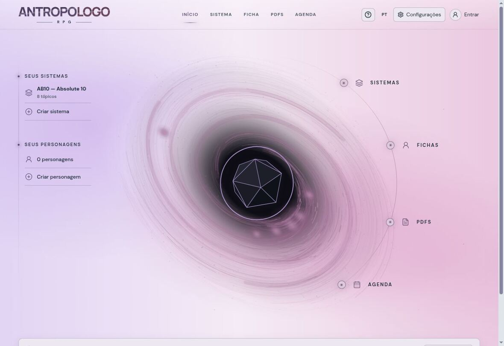

# Home Orbital v0.42

Na Home, mova o mouse sobre o D20 para girá-lo. Em uma tela de toque,
arraste o dado com um dedo. Pelo teclado, use Tab para focar o dado e as
setas para girá-lo. A área do dado bloqueia a rolagem por gesto durante
a manipulação. O restante da página continua rolável.

O giro usa quaternions para acumular a orientação. Movimentos horizontais
e verticais atuam nos eixos da tela. Ao sair da área ou soltar o dedo,
uma parte da velocidade se dissipa enquanto o giro automático retoma
a partir da orientação atual. Se um dos quatro atalhos orbitais estiver
ativo, o giro automático converge para 20%. A espiral usa sua própria animação.

A aparência e a geometria do icosaedro vêm da revisão anterior. Em movimento
reduzido, a rotação só acompanha os comandos diretos, sem inércia ou giro
automático. O selo de versão foi retirado da Home. A versão está em
**Configurações → Sobre**.

[Vídeo do giro por mouse](d20-mouse.mp4). Capturas reais da prévia no
Chromium, com um ponto sobreposto para indicar a posição do cursor.
A sequência mostra giro automático, gestos horizontais, verticais e
diagonais, uma inversão rápida, a retomada e o hover orbital.

A validação incluiu Chromium desktop e largura compacta por zoom, com
rolagem fora do dado. Toque, cancelamento de ponteiro e movimento reduzido
foram cobertos em DOM simulado e nos testes da animação. O build, TypeScript
e 418 testes automatizados passaram.
