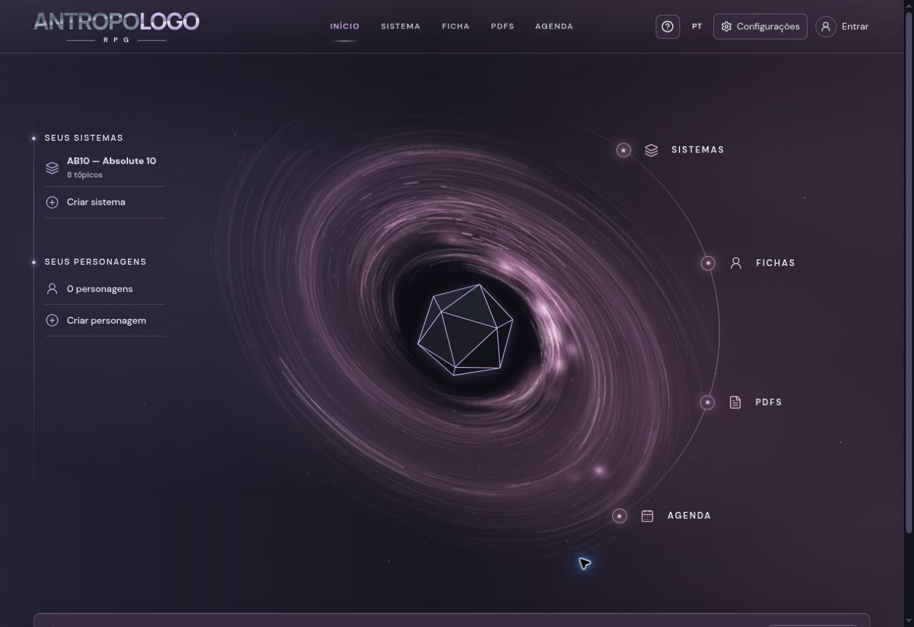
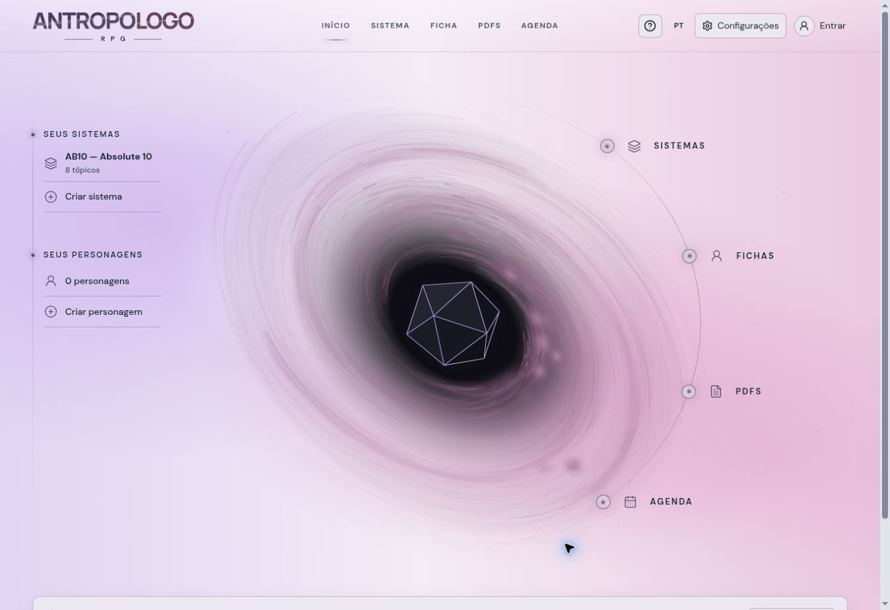
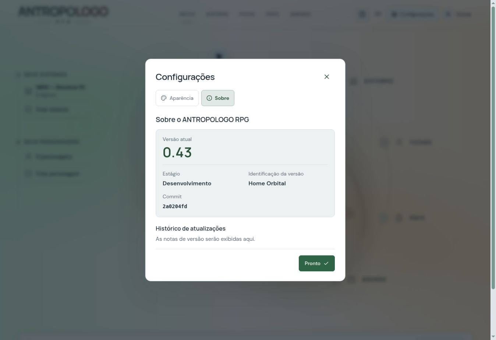
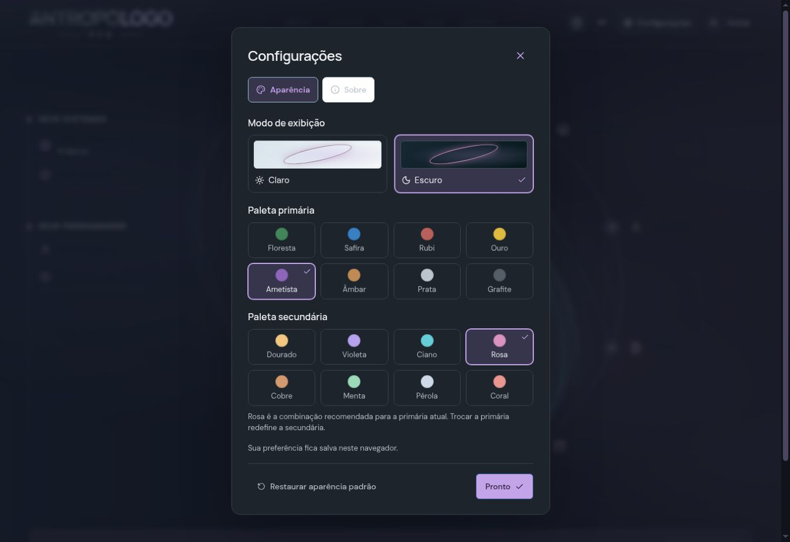
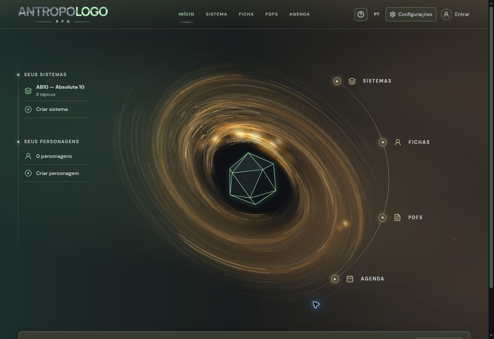
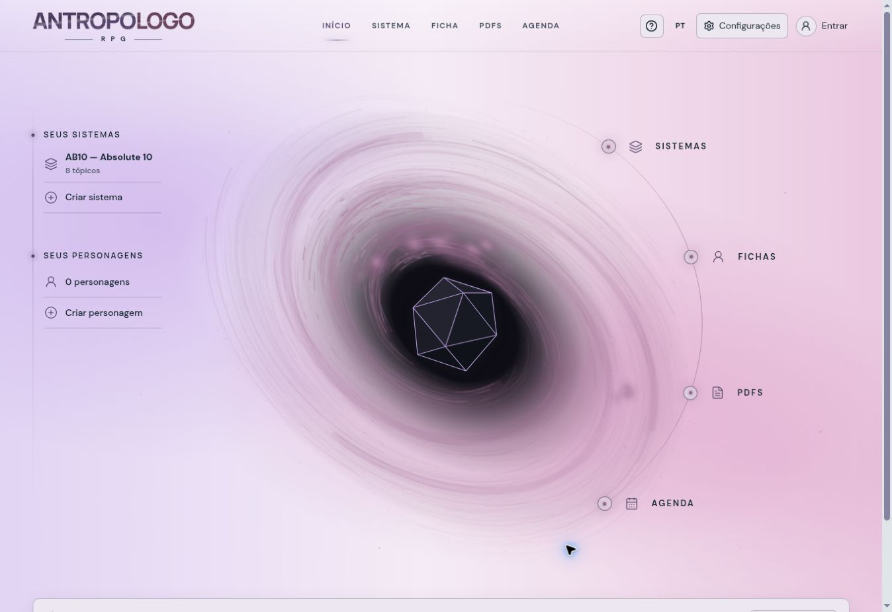
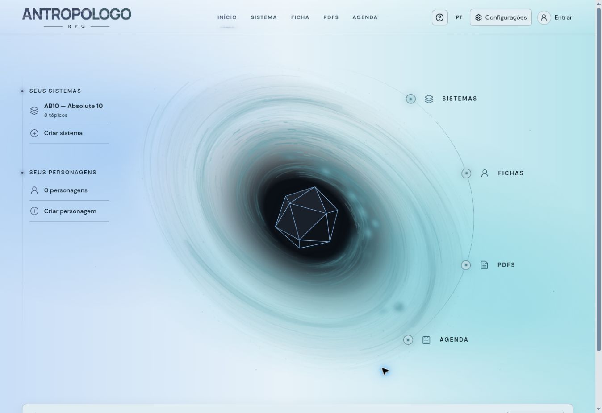
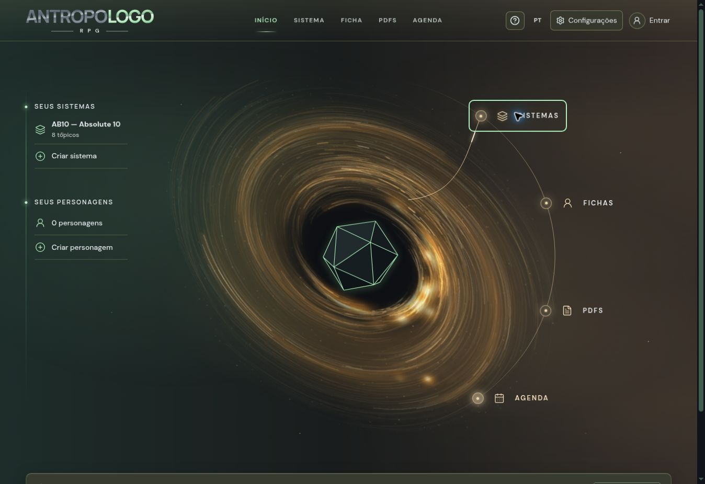
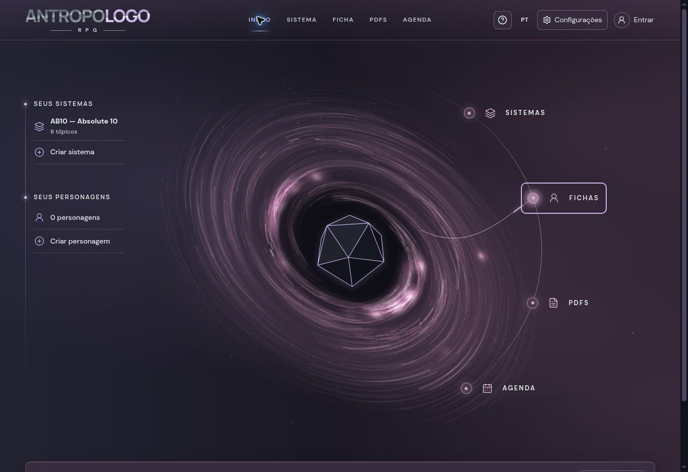

# Home Orbital v0.43

O disco reutiliza os filamentos procedurais e a poeira da Home em onze faixas
radiais com velocidades próprias. A região interna circula mais rapidamente,
enquanto a externa avança lentamente. A projeção elíptica e o centro do D20
seguem fixos. O núcleo permanece escuro nos dois modos de exibição.

Os quatro destinos recebem halo no hover ou foco. A ativação produz um anel,
uma cintilação e um pulso no único fio ativo, seguido da navegação em 140 ms.
Em movimento reduzido, a navegação é imediata e o disco fica estático.

## Demonstração

[Assistir ao vídeo do disco e das estrelas](disco-estrelas.mp4)

Vídeo de 12,7 segundos composto de capturas reais da prévia no Chromium,
preservando os intervalos de captura. Mostra fluxo automático, foco em
Fichas, PDFs e Agenda, troca rápida de destino, rotação direta do D20
pelo teclado e confirmação de Fichas com navegação. A exportação usa
20 quadros por segundo com repetição de quadros capturados.

## Publicação verificada

Publicação **95** no projeto original do ChatGPT Sites, com v0.43 confirmada
em Configurações → Sobre. O código no GitHub está no commit
`6895bec99d869b11485ee520b3b497735f48977d`. A fonte sincronizada no Sites está
no commit `2a0204fdccd69c37e939c5692f7c57fb6bc4686c`.

[Abrir o ANTROPOLOGO RPG](https://antrobologorpg.guss04.chatgpt.site/#inicio)

Os quatro destinos foram abertos pelo caminho orbital no site publicado.
Hover/foco manteve uma conexão ativa por vez. Paletas e modo persistiram após
recarga. O Canvas diferencial apresentou movimento, e o D20 conservou seu
centro durante a manipulação por mouse e teclado. As 20 faces mantêm
preenchimento opaco, com as traseiras ocultas.

As publicações 94 da v0.42 e 87 da Alpha permanecem arquivadas no mesmo
projeto para restauração. Configuração D1/R2, APIs, migrações e lockfile
foram comparados com a origem e preservados.

## Capturas da prévia

### Modo escuro

### Modo claro

### Estrelas

As capturas desta seção são da prévia. A validação incluiu os
quatro destinos reais, foco por teclado, rotação manual do D20 por mouse
e teclado, temas e paletas. TypeScript, build e 423 testes passaram.

Toque, movimento reduzido, pausa e cancelamento foram exercitados em
testes automatizados com DOM e relógio simulados. A ferramenta de navegador
disponível nesta execução não expôs emulação mobile ou de movimento
reduzido. A janela nativa auxiliar apresentou falha de captura gráfica.
A validação em aparelho físico e a medição de desempenho mobile ficam
pendentes.
