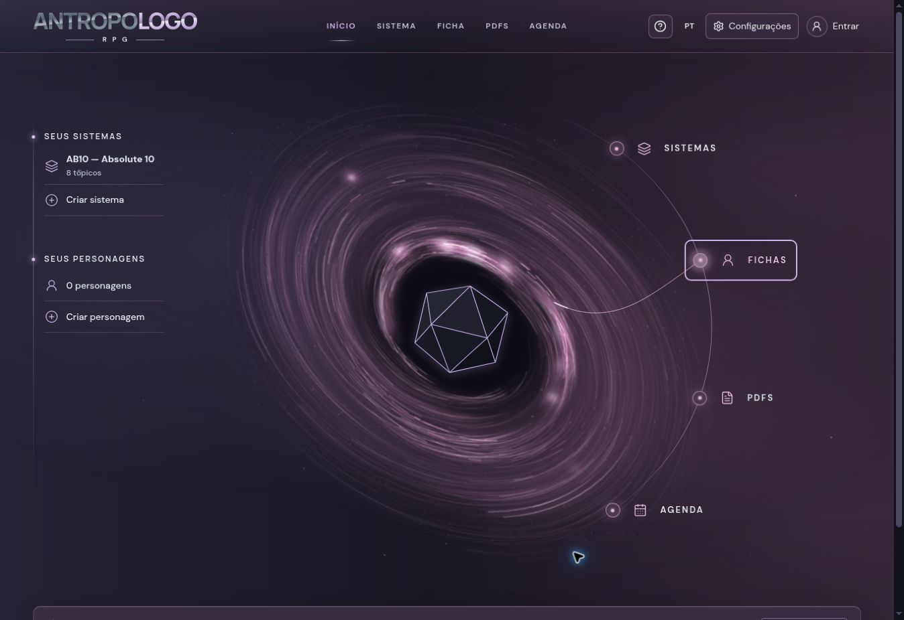
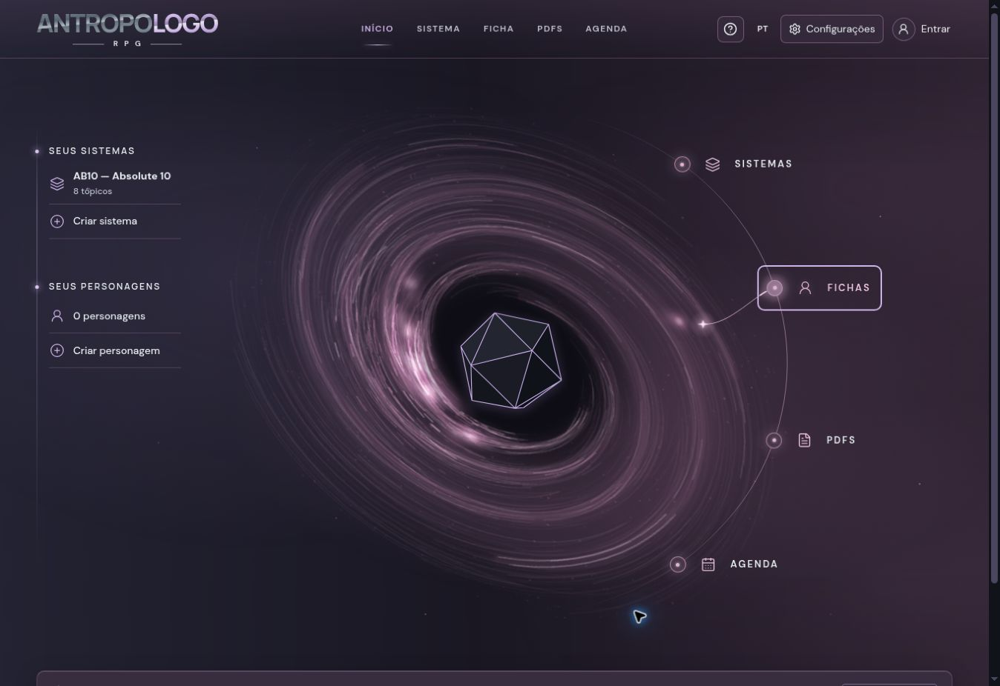
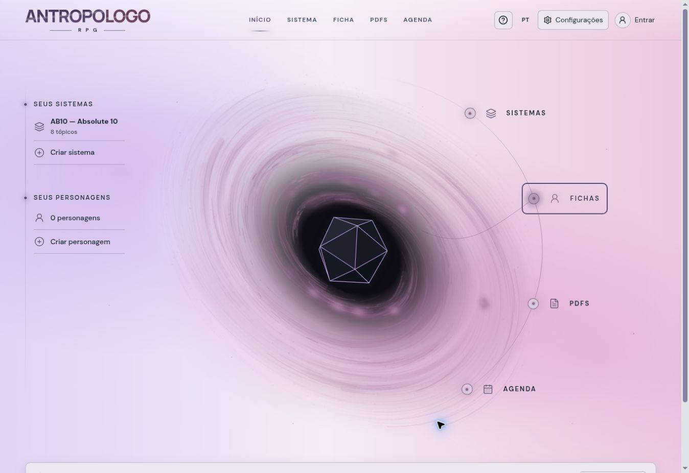
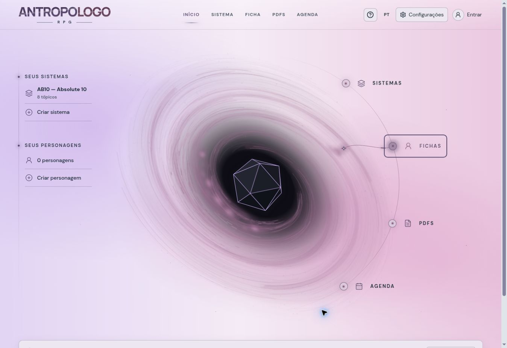
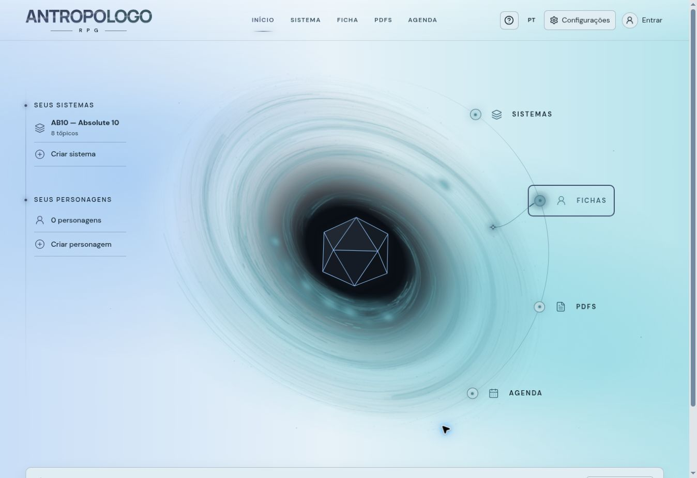
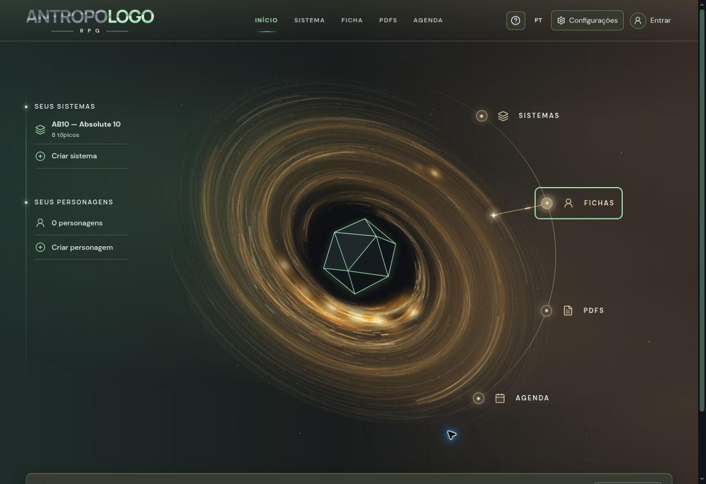
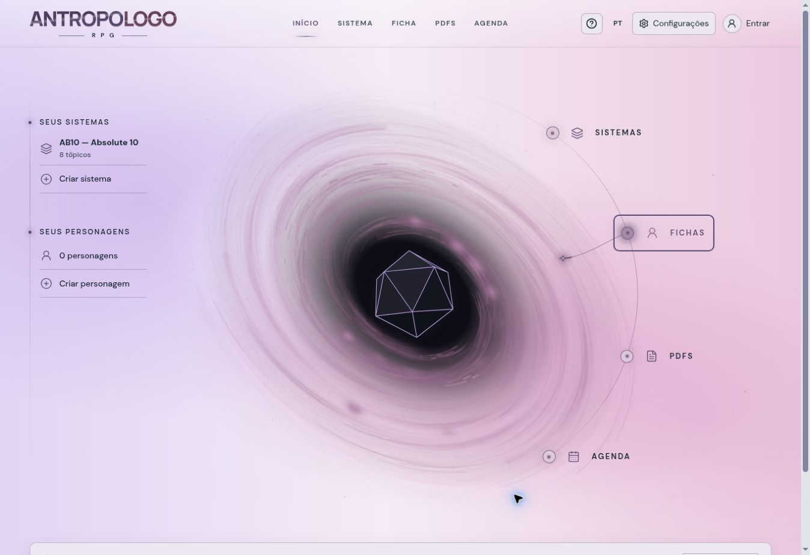
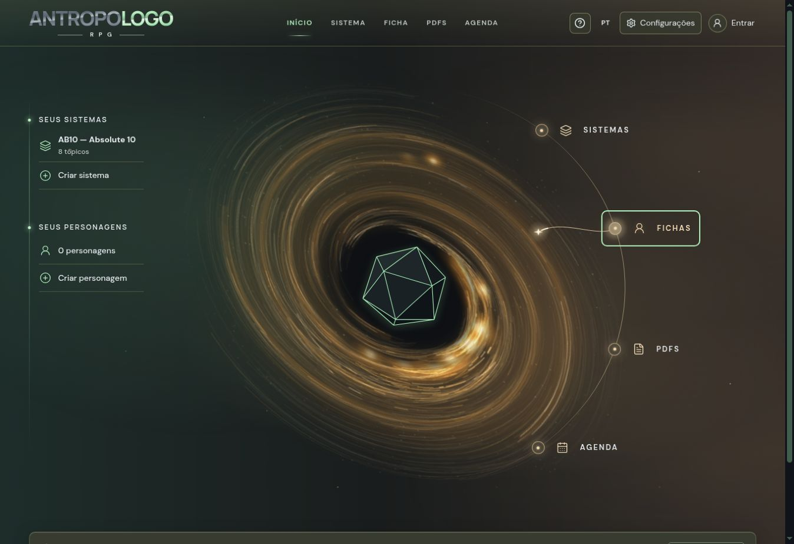

# Home Orbital v0.43 — Origem e conexões

Esta revisão mantém a identificação **0.43 — Desenvolvimento — Home Orbital**.
A base é o commit `fa2ec812e52d5bf5f10ff435d2c42703ac4593a7`, cuja aplicação
corresponde à publicação 95 do projeto original.

O fluxo teve o sentido invertido em relação à publicação 95. As onze faixas
continuam com velocidades diferentes. No hover ou foco orbital, a velocidade
converge até zero em cerca de um segundo. O D20 continua com seu próprio giro.
Ao sair da seleção, o disco acelera a partir da fase em que parou.

Uma estrela vetorial surge na borda elíptica do disco. Sua posição e a curva
Bézier são definidas por ativação, com variação limitada. A conexão anterior
desaparece antes da próxima surgir. A cintilação de confirmação usa a mesma
origem do fio. A navegação conserva a confirmação de 140 ms.

## Vídeos

[Ver fluxo, parada e os quatro destinos](validacao-fluxo-e-destinos.mp4)

Nova gravação real de 13 segundos da revisão: 240 capturas do Chromium,
com seus intervalos reais preservados, legendas e exportação em 30 fps.
Mostra o fluxo diferencial, a frenagem em Sistemas, as conexões de Fichas,
PDFs e Agenda, e a aceleração ao sair. Os quadros repetidos na exportação
não representam uma medição de desempenho do navegador.

[Ver a correção em movimento](disco-origem-selecao.mp4)

Registro real de 16,2 segundos da prévia no Chromium. Mostra fluxo automático,
foco em Fichas, desaceleração e parada, estrela na borda, troca de destino,
controle do D20 pelo teclado, retomada do disco e confirmação com navegação.
Os intervalos de captura foram preservados. A exportação usa 20 quadros por
segundo com repetição dos quadros capturados.

[Comparar com o movimento da publicação 95](antes-publicacao-95.mp4)

O registro anterior tem aproximadamente quatro segundos e foi capturado no
endereço público antes da publicação desta correção.

## Comparações

As imagens anteriores são da publicação 95. As imagens seguintes são da
prévia da correção, usando as mesmas paletas.

| Publicação 95 | Correção em prévia |
| --- | --- |
|  |  |
|  |  |

## Validação

427 testes automatizados, TypeScript e build passaram. No navegador, foi
confirmado que o disco mantém exatamente os mesmos pixels durante a seleção,
enquanto a orientação do D20 continua mudando. A estrela e o fio compartilham
as coordenadas da origem, e as trocas rápidas preservam uma conexão por vez.

O hover, foco, teclado, modos e paletas foram exercitados em desktop. Toque,
movimento reduzido, cancelamento e geometria compacta têm cobertura em testes
simulados. A inspeção em celular físico permanece pendente. As duas imagens
de referência mencionadas no pedido não estavam anexadas à mensagem recebida.
A direção foi comparada com a animação publicada e com o enrolamento dos
filamentos no código existente.

### Conferência da revisão

Os 427 testes foram executados novamente, sem falhas ou cancelamentos,
com o comando documentado da aplicação (`--test-force-exit`). TypeScript,
build, versão `0.43` e inspeção mecânica da interface passaram. O único aviso
de build continua sendo o tamanho de um bundle acima de 500 kB.

A pausa foi verificada novamente por comparação dos bytes de duas capturas
da mesma região do disco, enquanto a geometria renderizada do D20 mudou.
Também foram verificadas Ametista/Rosa no claro e Floresta/Dourado e
Safira/Ciano no escuro. As preferências persistiram após recarregar.

A [documentação técnica](../../../aplicacao/v0.40/docs/home-orbital-v043-correcao.md)
detalha a implementação, a pausa e as condições de restauração.
